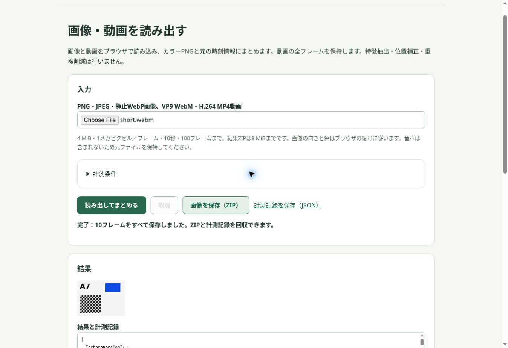

# 前処理なしのブラウザ基盤への切替結果

記録日: 2026-10-16 UTC。既存の計画・前回報告に付いた2026-10-17の日付は変更していない。

**基本処理への切替とGitHub Pagesへの公開反映は完了。画像の本番ZIP回収試験は未確認として残す。長期の処理速度・一般的な安定性・高速化成功は、今回の試験では評価していない。**

公開コード: `9086c48197b6e2391e39265585c15aed4d33c062`。Pages Actions `38960099272` 成功。後続 `98aad0177618096219785bda438f4ff7478920b7` はUnityの文書・開発用試験の更新で、配信コードに変更なし。

- 利用画面: https://kushyameln01.github.io/kushyameln-works/media-runner/
- 共有モジュール: [docs/shared/media-basic](../../docs/shared/media-basic/README.md)
- 呼出し側計測: [tools/media-baseline/trial.py](../../tools/media-baseline/trial.py)
- 元の高速化未達記録: [前回の本番報告](../media-production/RESULT-2026-10-17.md)

## 変更した動作

画像・動画をブラウザで復号し、全フレームをカラーPNGと時刻情報にしてZIPへまとめる。LBP、特徴抽出、位置補正、重複フレーム削減は実行しない。基本媒体モジュールから共有Worker pool／Wasmへの依存を除いた。既存のFT・Unity処理はそれぞれのWorker経路を維持し、同時進行していたUnity b4更新を取り込んだ。

前処理の42ファイルは、元commit・SHA-256・Git blobを記録して [development/media-preprocessing](../media-preprocessing/README.md) に保存した。Pages公開ディレクトリ`docs`から外してある。**GitHubのソースと履歴は公開のまま**であり、機密保管ではない。保存先は復旧用スナップショットで、そのまま実行できる独立アプリではない。Sitesには仮実装・開発用の前処理を保持した。

入力・子ジョブ・出力にtrialId、operationId、inputRevision、入力と出力のSHA-256を付与した。ZIP内manifestは梱包前、別の計測記録JSONはZIPハッシュと梱包後の計測を持つ。結果の確認には両方を保存する。

ブラウザ側は入力ハッシュ、復号、PNG化、出力ハッシュ、manifest、ZIP、Blob、画面への結果準備を分けて記録する。呼出し側はページ準備、投入、回収、展開、AI起動・読取り・回答受領を同じtrialIdで記録する。未観測区間はnullのままとし、ブラウザと呼出し側の時計を直接引き算しない。

端末内の履歴は100件・1MiBまで。古い記録の除外や保存失敗を表示し、JSONで書き出せる。集計先へ送るのは処理結果・時間・大まかなサイズ等の固定項目で、媒体・名前・入力／出力ハッシュは送らない。サーバー保存応答を表示し、結果生成とログ回収を分けた。新しいbuild/taskのログを従来の前処理ログと区別する。固定項目の記録保持は30日、既存の復号・PNG化・合計の集約値は90日。

出力上限8MiBをメモリ上限とは扱わない。出力を含むバッファ推定値、JSヒープ標本、イベントループの間隔、利用可能ならLong Tasksを残す。CPU／GPU／ネイティブ復号器の最大メモリは未測定。ZIPは同期処理のため、取消は前後の協調的な確認であり、梱包の途中に割り込む保証はない。

## 検証結果と範囲

| 対象 | 結果 | 根拠・制限 |
|---|---|---|
| 配信範囲 | 81/81ファイルの実配信SHA-256一致 | [取得記録](evidence/pages-acquisition.json)。すべて初回取得で一致 |
| 未公開化 | 39パスがHTTP 404 | [旧パス確認](evidence/pages-retired-paths.json)。旧媒体ファイル・labs・開発保存先の確認を含む |
| 共有Worker | module／bundleとも契約試験成功 | 実配信から取得したコピーで実行。[実行記録](evidence/pages-runtime-test.txt)。前処理5タスク拒否、FT・Unity b4継続 |
| 基本処理単体 | 9/9成功 | [TAP](evidence/basic-tests.tap)。全フレーム保持、識別・ハッシュ、上限・取消・再実行、履歴の容量不足、ログクライアント更新 |
| 公開規則 | 15/15成功、静的公開検査成功 | [既存公開試験](evidence/publication-tests.txt)、[静的検査](evidence/static-test.txt) |
| Sites試験 | 画像1枚・動画10枚のZIP回収と全ハッシュ検証成功 | [画像](evidence/sites-image.json)、[動画](evidence/sites-video.json)。回収後に始めたjournalであり総時間の測定ではない |
| Sites失敗系 | 出力上限超過・取消後に再実行成功 | 上限素材は入力3.54MiB。PNG出力上限でARTIFACT_LIMIT、完成ZIPなし。[上限](evidence/sites-upper-receipt.json)、[取消](evidence/sites-cancel-receipt.json)、[再実行](evidence/sites-recovery-receipt.json) |
| Pages画像 | 画面上の生成ready・ログACK 2件を確認。ZIP回収は未確認 | [計測記録](evidence/pages-image-receipt.json)、[回収失敗記録](evidence/pages-image.json)。ブラウザが返したZIP保存先の実ファイルが存在せず、標準保存による再試行でも未回収。JSONのみ回収。原因未特定 |
| Pages動画 | 10/10枚を回収・照合し、独立AIの回答まで成立 | [journal](evidence/pages-video.json)、[ZIP](evidence/pages-video.zip)、[計測記録](evidence/pages-video-receipt.json)、[AI回答](evidence/pages-video-ai-answer.json) |

動画を読んだAIには原素材・生成スクリプト・正答を渡さず、回収されたmanifestと10枚を確認させた。文字A7、青い長方形、白黒の市松模様、赤い正方形が現れる区間`[0.4,0.5)`を正しく回答した。合成画像・短い動画の確認であり、任意の画像・動画に対する品質保証ではない。元の合成入力は [fixtures](evidence/fixtures) に保存した。

Pages画像の失敗について、最初の回収処理が失敗した後に誤って付いたdownloadRecovered／aiStartマーカーは、無効として名前とvalid=falseを付けて残した。回収成功にもAI開始にも数えていない。ブラウザ内部のダウンロード一覧はURLポリシーで閲覧できず、その調査は中止した。処理コードが原因とも、環境だけが原因とも断定していない。動画の成功で画像の未確認を置き換えていない。

Sites最終版はv62、source `bed6d051665e9c8ff32bedc9230fcddbf7cd9aab`。[最終公開記録](evidence/sites-final-deployment.json)、[同梱ファイル照合](evidence/sites-final-artifact-hashes.json)、[最終画面の計測記録](evidence/sites-final-receipt.json)を保存した。保存archiveと公開成功、ブラウザ再実行は確認済み。CLIのSites GETは403となったため、**Sitesの実配信バイト一致は未確認**。GitHub Pagesは別途実配信を照合済み。

## 時間の読み方

| 試行 | ブラウザSDK内 | 入力開始→AI回答受領 | ページ準備を含む全体 |
|---|---:|---:|---:|
| Pages画像 | 0.034秒 | 未測定（ZIP未回収） | 未測定 |
| Pages動画 | 3.413秒 | 122.432秒 | 289.336秒 |

これは手動のクラウド経路確認であり、性能比較用のベンチマークではない。ページ準備の観測区間166.824秒には会話・記録整理等の待ち時間が含まれる。投入11.278秒、回収23.895秒、AI開始→回答受領57.816秒もツール操作・手順進行・待機を含む境界であり、純通信や純推論時間へ帰属させられない。AI読取りマーカー間は25.884秒だった。

新しいページで試したがキャッシュは消していない。キャッシュ状態はunknown。今回の値を以前のffmpeg基準や前処理付き試行にそのまま比較しない。ブラウザの色変換と別の復号経路との品質一致も新たには検証していない。

## 運用で基準値を蓄積する手順

1. 同じ入力・質問・品質条件を保ち、試行ごとに新しいtrialIdを使う。新しいページ／再訪／同じページでの再実行を区別し、キャッシュ状態は確認できた範囲だけ記録する。
2. 画面の基本処理を実行し、ZIPと計測JSONを両方保存する。失敗・取消・上限超過も履歴に残し、ログ保存応答とZIP回収を別々に扱う。
3. AI回答まで測る場合は`trial.py`で実際に観測した境界だけを記録し、`recover`によるハッシュ・入力対応の照合後にAIへ渡す。回収失敗時はAI開始へ進まない。自動化する呼出しコードは失敗時に後続処理を停止させる。
4. 履歴の件数・容量上限や30日／90日の保持期限を超える前に書き出す。画像・動画、解像度・長さ・重複率、文字・色・透明度・短いイベント等を分けて集計する。成功試行だけを選ばない。
5. 運用で観測したばらつきと必要な改善幅から、比較に必要な試行数を決める。ブラウザ内時間と回答までの総時間を別々に判断する。

運用期間や定期実行は今回指定・設定していない。長期集計、p95、速度向上の判定は今後の実使用後に行う。新しいSkillは作成していない。

## 五段階・監査

参照は保存済みの媒体用計画2.0 §4、技術Tips、作業ログ、前回の本番記録。元の開発手順確認チャット全文は未取得であり、その全文への完全準拠を主張しない。

| 段階 | 今回の履行 |
|---|---|
| 1 要件・経路 | 最新の「前処理なしで運用」を優先し、元の総時間短縮目標と分離。[計画](PLAN.md)に固定 |
| 2 早期の利用経路 | Sitesで実入力・ZIP回収を先に確認。Pagesでも動画のAI回答まで確認。画像の回収は未確認として記録 |
| 3 局所・全体の批評 | 公開依存と最終目的を独立監査。前処理除外とFT／Unity維持を照合 |
| 4 試験と最小実装 | 最初の契約試験を実装前に失敗させてから実装。監査でログクライアントの再接続不備が見つかり公開をHOLD、修正・再試験で解除 |
| 5 配布・試験・報告 | Sites→Pages、配信81一致／39パス404、失敗記録保持。独立監査はADVISE：公開切替は妥当、画像回収未確認と性能未評価を明記して終了可 |

期限切れ・一時503後のログクライアント復旧は独立した模擬通信と時計の試験で確認した。実運用環境を1時間停止させた試験ではない。同時進行の更新は強制上書きせず、最新mainを基準に反映した。

