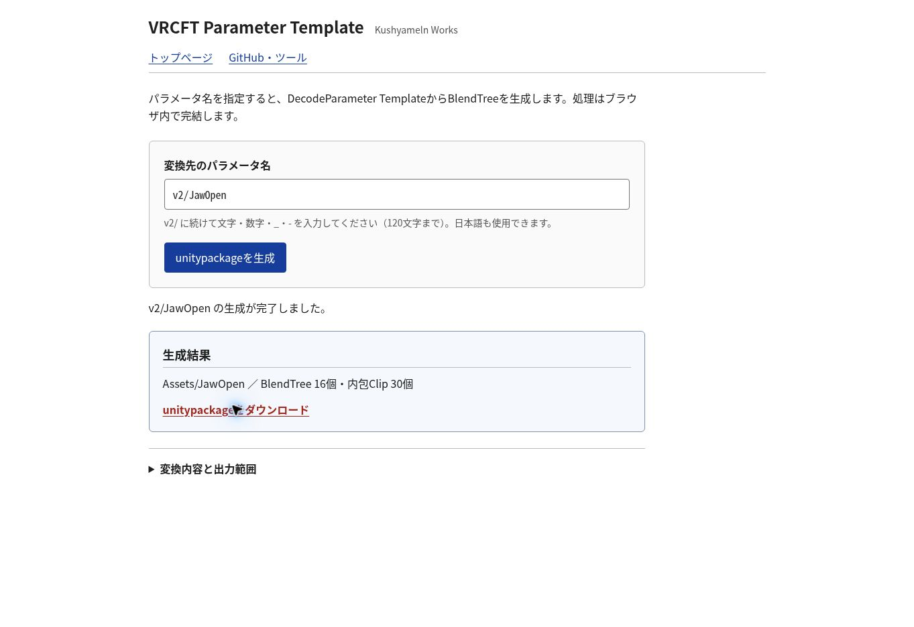

# 公開検証 2026-10-25

- Pages実装commit: 5f69e4c9694794abcb9e0c5c7cbd6f22a1ba635b
- Sites version: 91 / source 73b2eb50aec42b64b52962c21e2ee16de39bc38e
- 公開ページ: https://kushyameln01.github.io/kushyameln-works/parameter-template/
- Sites: https://kushyameln-works.vde6fedxrbh7fbbb740t.chatgpt.site/parameter-template/

## 合格した検証

Nodeで7回の生成を検査。EyeLidLeft、JawOpen、ParameterTest、数字始まり、hyphen、日本語を含む。新GUID、危険path拒否、16独立Tree、30内包Clip、34 Clip参照と13 Tree参照を確認。

Cloud browserで両公開HTTPS画面から実ファイルをダウンロード。独立Pythonで原本と全フィールドを比較し、指定名称・識別子・参照・binding CRC32以外を保持すること、GNU tar/gzip形式を確認。Unity Editorでの実行検証を意味しない。

|生成環境|対象|取得したunitypackage SHA-256|
|---|---|---|
|Sites|v2/EyeLidLeft|ba20b04a07e1f454a3ce32e4860987136d0334e8023c10e05733d4b1fb338137|
|Pages|v2/JawOpen|17f9cd7f349463df94f4ed47b96552ef181291978b78dc77b5f56919657710cb|

Pagesの公開6ファイルと一覧HTMLは承認したソースとHTTP取得bytesが一致。Sitesは公開UI・実ダウンロードを確認（terminal HTTP取得は403であり、byte一致は未判定）。Sites buildは332承認静的ファイル、388 artifact files。

空欄エラー、生成後の入力変更による古いdownload失効をCloud browserで確認。取消操作は高速完了のため実行中に押せず、コードレビューのみ。HTTPプレビューでdownload通知timeoutが起きたが、公開HTTPSでは両サイトとも実ファイル回収成功。

## 検証範囲と未確認

- 既存Pythonテスト46件は通過。
- 旧relocation検査は古いbaselineとのWASM loader差分で失敗。対象 docs/shared/ft/kernel/load-kernel.mjs は作業開始commit63aa890とbytes一致しており、今回変更していない。旧テストや既存loaderを書き換えて回避しない。
- Unity Import、Unity上のasset型、Animator/VRChat実動作は未確認。
- 指定外Proxy/Function/Smooth機能名は保持。複数生成物を同一Animatorへ入れた場合の中間Parameter独立化は未指定。
- 未参照Decode_All Clip、Controller、Expression、Prefabは出力範囲外。0用補助Treeの接続・数値を原本通り保持。

公開画面: 
