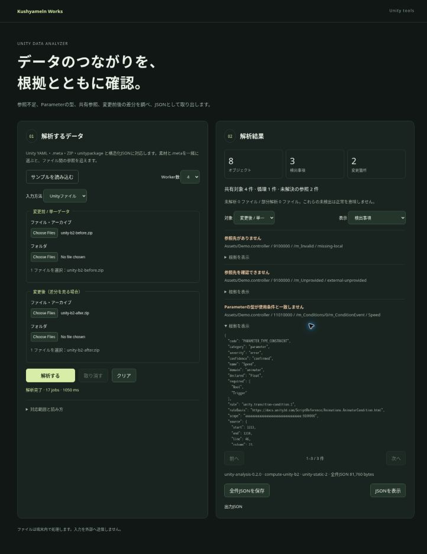

# Unityデータ解析：実装・検証結果

2026-10-16。Kushyameln Works に Unityデータ解析 v0.2.0 を実装・公開しました。

[GitHub Pagesで開く](https://kushyameln01.github.io/kushyameln-works/unity-analyzer/)

## できること

- Unityテキストファイルと .meta、フォルダー、ZIP、unitypackage、構造化JSONから解析。
- 参照不足、Parameterの型不一致、共有参照、循環、変更前後の差分を表示。
- GUID/fileID、プロパティの位置、判定根拠、入力ハッシュ、未解析部分を含む全件JSONを出力。
- 既存の共有Workerプールを使い、1・2・4 Workerに対応。Hike/WASMカーネルと共有SDKは他ツールから再利用可能。
- 解析取消、入力変更時の古い結果の失効、取消後の再実行に対応。入力はブラウザ内で処理。

変更前と変更後のファイルを選択し、「解析」を実行してください。結果の詳細で根拠を確認し、全件JSONをダウンロードしてChatGPTへ渡せます。

## 確認した範囲

GitHub Pagesの配信成功と66ファイルの同一性を確認した後に、製品の実行試験を行いました。1/2/4 Worker × モジュール再利用の有無を試験し、ファイル・ZIP・unitypackageで意味上の結果が一致しました。別の利用者の処理との共存、取消、タイムアウトや不正ZIPからの復帰も確認しました。

公開HTTPSページで実際に前後のZIPを選択し、141,485 bytesの全件JSONを回収しました。内容と入力ハッシュは別の実行記録に一致しています。表示は8オブジェクト、3指摘、2変更、共有参照4件、循環1件。ブラウザで取消、Worker設定変更時の結果クリア、再解析も確認しました。

合成入力によるNode上の45回の測定では、複数Workerの解析区間が重なりました。最大の試験素材は87,744 bytes・1,024オブジェクトで、全体時間中央値は1/2/4 Workerで2273.9/1287.9/813.4 msです。一般のUnityプロジェクトでの速度保証やWASM単独時間の測定ではありません。

## 対応範囲の制限

Unity YAMLは明示した部分集合に対応します。未対応構文・バイナリは未解析として残します。AnimatorStateのSpeed/CycleOffset/Mirror/Timeで使うParameterの型制約は未確定として表示し、AnimatorとExpressionの対応には明示的な関連情報を使います。Unity Editor上の動作を保証する試験ではありません。

元の「開発手順確認」チャットは抜粋のみ取得できたため、保存済みの手順全文・今回の指示・承認済み計画を準拠根拠にしています。独立レビューと監査の指摘を修正し、実行前の静的確認、Pages更新後の実行、証拠保存の順で進めました。

## 版と記録

- 検証対象Pages: `6dc93eafd86caf2bc1418c79bad5fe76e8bf25c3`、配信workflow `38925723680`。
- 製品実装Sites: v57、source `39abed6b11fa9f9e070832dff6c3926c5e3a641b`。
- 初回core試験は13/14成功。試験素材のGUID誤記を訂正し、該当1件が成功しました。製品の変更はありません。
- 完全なブラウザ版番号と個別HTTP応答ハッシュは未取得。実行環境・観測範囲の限界として記録しています。
- 詳細: [VALIDATION.md](VALIDATION.md)、[WORKLOG.md](WORKLOG.md)、[DESIGN.md](DESIGN.md)。生の試験結果・全件JSON・画面は `evidence/full-input/` に保存。

