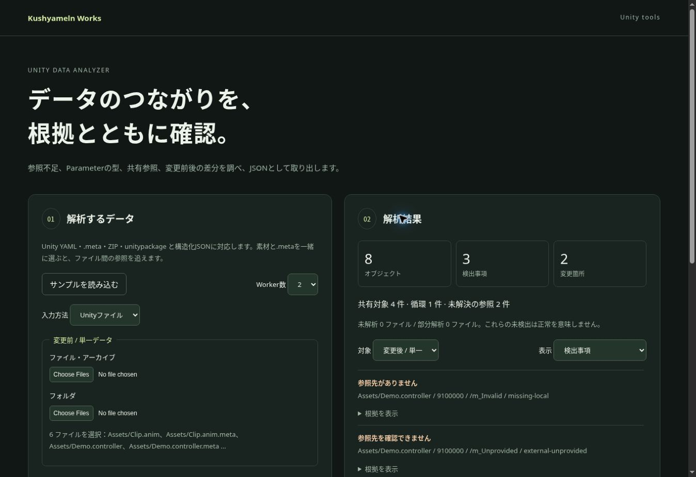

# Unityデータ解析：実装・検証結果

2026-10-17 JST（2026-10-16 UTC）。現行版は **v0.3.1 / `compute-unity-b4`** です。GUIDの同定、全件JSONの生成、複数ファイルの解析、ZIP展開時のバッファ所有権を改善し、公開後の機能・性能試験を完了しました。

[GitHub Pagesで開く](https://kushyameln01.github.io/kushyameln-works/unity-analyzer/)

## できること

- Unityテキストファイルと .meta、フォルダー、ZIP、unitypackage、構造化JSONから解析。
- 参照不足、Parameterの型不一致、共有参照、循環、変更前後の差分を表示。
- GUID/fileID、プロパティの位置、判定根拠、入力ハッシュ、未解析部分を含む全件JSONを出力。
- 既存の共有Workerプールで1・2・4 Workerに対応。Hike/WASMカーネルと共有SDKは他ツールから再利用可能。
- 解析取消、入力変更時の古い結果の失効、取消後の再実行に対応。入力はブラウザ内で処理。

変更前と変更後のファイルを選択して解析し、全件JSONをChatGPTへ渡せます。画面の絞り込みやページ移動は、保存するJSONの内容を省略しません。

## 今回の変更

- GUIDの大文字・小文字を同一性の判定で正規化しました。ファイル・オブジェクト・Parameterの所有範囲と関連付けに同じ規則を使い、元の値、パス、入力ハッシュを保持します。重複GUIDを一意と扱うことはありません。
- 結果確定時にcompact JSONのバイト数を一度だけ計算します。全文の整形は最初の表示または保存時に行い、同じ結果では再利用します。クリアや画面離脱時にキャッシュを解放します。
- 小さいファイルを最大8件・合計256 KiBの解析ジョブへまとめます。大きいファイルは単独で処理し、同時実行数と合計16 MiBの投入上限を維持します。SDKの `parseBatchSize: 1` で従来の単独処理を選べます。
- ZIPは検証済みの展開長に合わせた一つの出力バッファへ逐次コピーします。CRC、実際の展開長、パス衝突、件数・容量制限を維持しました。コピー総量の削減やRSSの有意な改善を確認したという意味ではありません。

Module再利用は既定 `false` を維持しています。各ジョブにWorkerを作成して終了する方式も維持し、常駐Workerや全入力のストリーミングは導入していません。

## 現行版で確認した範囲

期待値を先に作成し、静的確認・ビルド、Sites保存、Pages配信成功、対象ファイルの同定を済ませてから実行試験を行いました。現行版の回帰試験は **24/24成功**、raw SDKは **1/2/4 Worker × Module再利用の有無の6条件で成功**。直接ファイル・ZIP・unitypackageの意味上の一致、全件inventory、取消・復帰、別利用者との分離を確認しました。

公開ブラウザでも、v0.3.0では123件の指摘を表示してページ・フィルター・前後切替を操作し、compact生成1回・整形0回のまま表示が更新されることを確認しました。初回保存後の整形は1回で、表示全文と347,439-byteの保存JSONが一致しています。v0.3.1では8オブジェクト、3指摘、画面上2変更、共有参照4件、循環1件を確認し、129,440-byteの保存JSONと表示全文が一致しました。取消と入力変更による失効後に、遅れた結果が再表示されないことも確認しています。

### Node上の性能比較

同じ合成入力の単一スナップショットを `analyze()` で解析しました。比較元の「旧」はGUID/cache修正後の **v0.3.0 / Pages `1a3bd7ce3791cdd18a0eda7fd569b46e5cdd2b05`** であり、初回公開v0.2.0ではありません。Node v24.19.0、毎回新しいプール、Module再利用なし、各条件5回の **呼出し側全体時間 `outerWallMs` の中央値** です。ブラウザの性能値や前後比較 `compare()` の測定ではありません。

| 入力 | 1 Worker：旧 → 現行 | 2 Worker：旧 → 現行 | 4 Worker：旧 → 現行 |
|---|---:|---:|---:|
| small：6ファイル・2,287 bytes・8 objects | 505.2 → 149.2 ms | 299.1 → 149.0 ms | 226.1 → 168.5 ms |
| manySmall：64ファイル・13,612 bytes・128 objects | 4358.0 → 645.5 ms | 2399.1 → 393.7 ms | 1432.3 → 240.4 ms |
| large：8ファイル・89,720 bytes・1,024 objects | 742.7 → 254.3 ms | 441.3 → 268.0 ms | 343.5 → 267.5 ms |

基準版と現行版はそれぞれ114サンプルを記録し、3素材の入力ハッシュと機能上の結果が一致しました。manySmallは1/4 Workerで85.2%/83.2%短縮し、事前に定めた採用条件（15%以上短縮、小入力の悪化10%以内）を満たしています。この数値基準はユーザーの指定ではなく、測定前に固定した実装側の提案です。この合成入力での結果であり、任意のUnityプロジェクトに対する速度保証ではありません。

初回の候補測定は最後の版メタデータ比較で失敗し、サンプルを出力できませんでした。製品は変更せず、比較時だけ `before.analyzerVersion` と `after.analyzerVersion` を明示した基準版へ揃えて114サンプルを再測定しました。生の版・意味ハッシュは保持し、機能値・規則版・パス・入力ハッシュは比較から除いていません。失敗時のstderrも保存しています。

### メモリ観測

63/64 MiB展開では全件inventoryを保持し、65 MiBでは明示的な容量制限エラーになりました。観測RSS最大値は63 MiB入力で219.2 → 217.0 MiB、64 MiB入力で225.2 → 224.7 MiBでした。これは各ケース別のNodeプロセスで10 ms間隔などにより採った観測値で、短いピークを見逃し得ます。**RSSの有意な改善、コピー総量の削減、ブラウザのメモリ量、64 MiBのプロセスメモリ上限は主張しません。**

## 公開版と証拠

- 改善版の性能・メモリ・ブラウザ測定対象Pages：`aa4b92cd9e8f6189ee3ab8e59a86e231513d5486`。workflow `38958327066` は `2026-10-16T19:54:45Z` に成功状態を確認。
- 同じ改善版の実装Sites：v60、source `4efa8dc07eda382d5b4ca711a9c79f2f36779bf6`。
- 107 public blobsを配信成功commitのGit blobとSHA-256で同定してクラウド複製上で実行しました。個別CDN応答のバイトを全件取得したという意味ではありません。公開HTTPSブラウザの操作・保存JSONは別の実証記録です。
- 現行証拠：[証拠案内](evidence/improvements/README.md)、[生の記録を収録したZIP](evidence/improvements/evidence.zip)、[ファイル別ハッシュ](evidence/improvements/manifest.json)。性能・メモリ・全件JSONの大きな記録はZIP内の同名ファイルを参照してください。
- 詳細：[VALIDATION.md](VALIDATION.md)、[WORKLOG.md](WORKLOG.md)、[DESIGN.md](DESIGN.md)。

最終記録の保存直前に、別作業のメディア更新 `9086c48197b6e2391e39265585c15aed4d33c062` が公開されました。その更新を保持し、配信成功後のUnity依存38ファイルを同定して、24回帰とSDK6条件を再確認しました。すべて成功しています。Unityの分析ソース・UI・WASMは同一ですが、共用registryとbundleが変わっているため、上記の性能値は引き続きaa4版の測定値として扱います。[最新構成の統合記録ZIP](evidence/improvements/final-integration.zip)を追加し、元の証拠ZIPは変更していません。Sitesも最新v62を基点に、今回の記録だけを統合します。

## 対応範囲の制限

Unity YAMLは明示した部分集合に対応します。未対応構文・バイナリは未解析として残します。AnimatorStateのSpeed/CycleOffset/Mirror/Timeで使うParameterの型制約は未確定として表示し、AnimatorとExpressionの対応には明示的な関連情報を使います。Unity Editor上の動作、任意のUnity/SDK版、大規模な実プロジェクト全般を保証する試験ではありません。

ブラウザの完全な版番号と個別HTTP応答ハッシュは未取得です。v0.3.1公開直後の初回読込みでは診断UIが出ず、一度の通常再読込みで復帰しました。原因は未確定で、記録に残しています。

元の「開発手順確認」チャットは抜粋のみ取得できたため、保存済みの手順全文・今回の指示・承認済み計画を準拠根拠にしています。

## 旧版の記録

v0.2.0 / `compute-unity-b2` は2026-10-16に公開した初回のraw入力対応版です。Pages `6dc93eafd86caf2bc1418c79bad5fe76e8bf25c3`、Sites v57を対象とし、66ファイルの同定、公開ブラウザのZIP入力・141,485-byte JSON回収、合成入力45回の測定を行いました。**この45回の性能値は現行版の測定ではありません。** 当時のcore試験は初回13/14成功で、試験素材のGUID誤記だけを訂正して該当1件が成功しました。製品変更はありません。

当時の詳細と制約は [VALIDATION.md](VALIDATION.md) の歴史節と `evidence/full-input/` に残しています。

